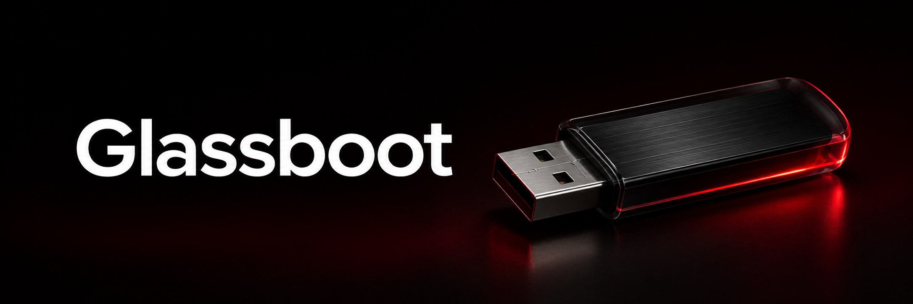
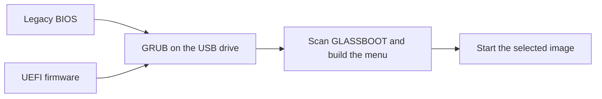

<h1 align="center">
  
</h1>

<p align="center">
  <strong>One USB drive for Linux live ISOs, Windows installers, and rescue tools.</strong>
  <br>
  Install Glassboot once, copy your images onto the drive, and pick one at boot.
</p>

<p align="center">
  <a href="#quick-start">🚀 Quick start</a> ·
  <a href="#how-it-works">⚙️ How it works</a> ·
  <a href="#compatibility">💿 Compatibility</a> ·
  <a href="#build-from-source">🛠️ Build from source</a> ·
  <a href="ROADMAP.md">🗺️ Roadmap</a>
</p>

> [!NOTE]
> Glassboot is in early development. The boot payload supports legacy BIOS and x86-64, 32-bit x86, and ARM64 UEFI. Secure Boot support is planned. The desktop installer runs on Windows and Linux x86-64. [Platform notes](docs/ARM64-AND-NETBOOT.md)

<a name="quick-start"></a>

## 🚀 Quick start

| Host | Open the installer |
| --- | --- |
| 🪟 **Windows x64** | Extract the complete portable ZIP and run `glassboot-installer.exe` from the extracted folder. Approve the Windows elevation prompt. |
| 🐧 **Linux x86-64** | Make the AppImage executable with `chmod +x Glassboot-*-linux-x86_64.AppImage` and run `./Glassboot-*-linux-x86_64.AppImage`. The installer can restart with elevated permissions when it needs to write the drive. |

Build the portable package using the [instructions below](#build-from-source), or use the Windows or Linux artifact from a successful run of the [release workflow](.github/workflows/release.yml). The [release guide](docs/RELEASING.md) covers checksums, signatures, and running the AppImage without FUSE.

> [!CAUTION]
> **Install** and **Reinstall** erase the selected drive. Back up its contents and verify the drive name and capacity before confirming.

1. **Prepare the USB.** Plug it in, open Glassboot Installer, select the drive, and click **Install**. The installer partitions the drive, writes the boot files, and verifies the result.
2. **Copy your images.** Open the new **GLASSBOOT** volume and copy files such as `.iso` or `.wim` onto it. You can organize them into folders like `Linux/`, `Windows/`, and `Rescue/`. Copy each image as a file.
3. **Boot from USB.** Restart the target computer, open its firmware boot menu, and choose the USB drive. Select an image in the black and red Glassboot menu and press **Enter**. Use images that match the target computer’s architecture.

To add or remove an image, copy or delete the file on **GLASSBOOT**. To upgrade the boot files on an existing Glassboot drive, select it in the installer and choose **Update**. Update keeps the data partition and its images. [Installer and CLI reference](Utility-Source/README.md)

### 🎛️ Boot menu controls

| Key | Action |
| --- | --- |
| **F3** | Search by filename, folder, or menu name |
| **F4** | Boot an operating system from another drive |
| **F5** | Calculate a checksum for a boot image |
| **F6** | Try an alternate boot mode, such as an ISO’s `loopback.cfg` or the UEFI virtual CD |

Open **Settings…** in the installer or edit `glassboot/glassboot.cfg` on the USB to set a default image, set a timeout, group entries by folder, rename images, or add a GRUB theme. Per-image options include Linux kernel arguments and persistence. See [menu configuration](docs/CONFIG.md) and [storage and unattended installs](docs/STORAGE-AND-UNATTENDED.md).

<a name="how-it-works"></a>

## ⚙️ How it works

Glassboot uses two partitions. The installer writes a small **EFI System Partition** with GRUB and its helpers, and creates a larger **GLASSBOOT** data partition formatted as exFAT by default. Legacy BIOS starts GRUB from the disk’s boot code. UEFI starts it from the EFI partition. Both paths use the same USB menu configuration.



On each boot, the Glassboot GRUB module scans the data partition and generates the menu from the files it finds. What happens next depends on the image you choose.

- 🐧 **Linux ISO.** GRUB opens the ISO as a loopback device and loads its boot files. Glassboot’s early Linux hook makes the ISO file available to the live system as a block device.
- 🪟 **Windows ISO or WinPE.** Glassboot starts `boot.wim` with wimboot. For Windows installers, the WinPE helper mounts the original ISO so Setup can read the installation files.
- 💽 **Other media.** On UEFI, Glassboot can present compatible images as virtual CDs or disks and launch their EFI loaders. Legacy BIOS can use memdisk to load supported images into RAM.

The build compiles the boot components from in-repo source and pinned, verified upstream source. The Windows and Linux installers write the same boot payload. [Architecture and boot paths](docs/ARCHITECTURE.md)

<a name="compatibility"></a>

## 💿 Compatibility

| What you copy | What to expect |
| --- | --- |
| **Linux live and installer ISOs** | Alpine, Arch, Debian Live, and Fedora KDE have booted in QEMU on tested firmware. ARM64 Alpine reaches login in ARM64 UEFI QEMU. |
| **Windows installer ISOs** | Windows 11 24H2 and Windows Server 2025 reach Setup in BIOS and UEFI QEMU. See the ARM64 notes for Windows limitations. |
| **WinPE ISOs and `.wim` files** | Hiren’s BootCD PE has reached the desktop on UEFI. Large `boot.wim` files can exceed legacy BIOS memory limits. |
| **FreeBSD ISO and memstick images** | FreeBSD 15.1 has a tested RAM-root path for supported stock images on BIOS and UEFI. It needs enough RAM to hold the image. |
| **`.img`, `.vhd`, and `.vhdx` disk images** | Support depends on the firmware mode, image format, and guest OS. See the disk-image guide for supported layouts and limits. |
| **`.efi` programs** | Launch directly from the UEFI menu when they match the firmware architecture. |

Glassboot also has Linux **PXE** tooling for Ubuntu Casper and Debian Live media. Use the [ARM64 and network boot guide](docs/ARM64-AND-NETBOOT.md), [disk image and FreeBSD validation](docs/DISK-IMAGE-VALIDATION.md), and [roadmap](ROADMAP.md) for the tested cases and known limits.

<a name="build-from-source"></a>

## 🛠️ Build from source

The build has two parts. First compile the boot payload on Linux. Then compile the desktop installer and CLI on your host OS and package them with that payload.

### 1. Build the boot payload

Use Ubuntu 24.04 or a compatible Debian/Ubuntu environment. On Windows, use WSL2 with Ubuntu and open the same repository checkout from both WSL and PowerShell. Run these commands from the repository root.

```bash
sudo bash scripts/install-deps.sh
bash scripts/build.sh all
bash scripts/build-payload.sh
python3 scripts/release.py verify-payload out/payload
```

The build produces GRUB, wimboot, memdisk, the Linux initrd hook, and the WinPE helper. The payload in `out/payload/` contains the boot images and their SHA-256 manifest.

### 2. Compile the installer and CLI

<details open>
<summary><strong>🪟 Windows x64 · MSVC and Qt</strong></summary>

<br>

Install Visual Studio 2022 Build Tools with **Desktop development with C++**, CMake, Python 3.10+, and **Qt 6.8.3 for MSVC 2022 x64** with Qt Tools and Linguist. In PowerShell, set `$qt` to your Qt SDK directory.

```powershell
$qt = 'C:/Qt/6.8.3/msvc2022_64'
$env:PATH = "$qt/bin;$env:PATH"
cmake -S Utility-Source -B build/release-windows -G 'Visual Studio 17 2022' -A x64 "-DCMAKE_PREFIX_PATH=$qt" -DCMAKE_AUTOGEN_PARALLEL=1
cmake --build build/release-windows --config Release
ctest --test-dir build/release-windows -C Release --output-on-failure
```

The compiled executables are in `build/release-windows/Release/`. To assemble a portable folder and ZIP with the Qt libraries, MSVC runtime, and boot payload, run:

```powershell
./scripts/package-windows.ps1 -QtDir $qt
```

Open `dist/Glassboot-<version>-windows-x86_64/` and run `glassboot-installer.exe`, or share the complete ZIP from `dist/`.

</details>

<details open>
<summary><strong>🐧 Linux x86-64 · CMake and Qt</strong></summary>

<br>

```bash
cmake -S Utility-Source -B build/linux -G Ninja -DCMAKE_BUILD_TYPE=Release
cmake --build build/linux
ctest --test-dir build/linux --output-on-failure
./build/linux/glassboot-installer --payload out/payload
```

To build a portable AppImage, install the packaging dependencies and run:

```bash
sudo apt-get install -y libtool-bin libfuse3-dev libzstd-dev squashfs-tools patchelf
bash scripts/package-linux.sh
```

The AppImage is written to `dist/`. See the [release guide](docs/RELEASING.md) for packaging and the [installer reference](Utility-Source/README.md) for CLI-only builds.

</details>

### 🧪 Test without a USB drive

On Linux, use a new disk image and a test ISO you already have. QEMU boots from the image file, so you can try the menu without connecting a USB drive. Substitute the actual path to your ISO.

```bash
sudo bash scripts/mkusb.sh --image out/glassboot.img --size 8G
sudo bash scripts/add-iso.sh out/glassboot.img /path/to/test.iso
bash scripts/test-qemu.sh bios out/glassboot.img
bash scripts/test-qemu.sh uefi out/glassboot.img
```

For a headless capture, run `bash scripts/screenshot.sh uefi out/glassboot.img out/grub-menu.png 12`.

## 📚 Documentation

| Guide | What it covers |
| --- | --- |
| [Architecture](docs/ARCHITECTURE.md) | Partition layout, GRUB, Linux and Windows boot paths |
| [Configuration](docs/CONFIG.md) | Menu settings, persistence, and per-image boot options |
| [Installer and CLI](Utility-Source/README.md) | Windows and Linux installer builds, commands, and tests |
| [Releasing](docs/RELEASING.md) | Portable packages, manifests, checksums, and signing |
| [Roadmap](ROADMAP.md) | Implemented features, development status, and planned work |
